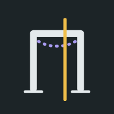

<p align="center"></p>

<h1 align="center">Frame MAS</h1>

<p align="center"><b>Free, open-source 2D frame and truss analysis for engineering students.</b><br>
Draw on an ETABS-style grid, apply BNBC 2020 or ASCE 7-16 load combinations, and read exact axial force, shear and bending moment values, deflections and reactions, on the frame, in tables and in 3D.</p>

<p align="center">
  <a href="https://al-shahriar-12.github.io/frame-mas/"><b>Open Frame MAS</b></a> ·
  <a href="#how-to-use">How to use</a> ·
  <a href="FRMAS-FORMAT.md">.frmas file format</a> ·
  <a href="CONTRIBUTING.md">Contribute</a> ·
  <a href="#author">Author</a>
</p>

<p align="center">
  
  
  
</p>

<p align="center">
  
  
  
  
</p>

## What it does

- **ETABS-style grid:** vertical grid lines with circled labels and named levels. Joints snap to grid crossings and to a snap spacing. **Build frame** creates a regular multi-bay, multi-storey frame in one step.
- **Draw and edit:** draw members joint to joint, drag joints to move them, select several items at once, delete, undo and redo.
- **Members and supports:** sections (I, rectangle, circle, pipe or custom) and materials; rigid or hinged member ends; truss members; fixed, pinned, roller and guided supports.
- **Loads:** joint forces and moments, distributed loads (full or partial, uniform or varying) and point loads, acting by gravity, along global X or Y, or normal to the member. Self-weight is set per load case.
- **Load cases and combinations:** Dead, Live, Roof live, Rain, Snow, Wind, Earthquake, Fluid pressure, Soil pressure and other cases. Generate **BNBC 2020** strength (USD) or service (ASD) combinations, or ASCE 7-16 strength (LRFD) combinations, in one tap, or write your own. See the envelope of all combinations.
- **Results on the frame:** bending moment on the tension side, shear, axial force (blue tension, red compression), magnified deflected shape and support reactions, each with values.
- **Diagram values:** a panel beside the frame lists every member’s SFD, BMD, AFD or deflection values at its start, middle and end, with the exact maximum and minimum and where they occur. Tap a member for its peak values, a table at the ends, quarter points and both sides of every point load, a section cut you can drag along it, and its four diagrams.
- **Summary:** reactions, member forces, joint displacements, storey drift, an equilibrium check for every load case, and the degree of static indeterminacy.
- **3D view:** members drawn as real sections, with diagrams and the deflected shape.
- **Units, files and appearance:** SI (kN and m, N and mm) and US (kip and ft, kip and in, lb and ft); save and open `.frmas` files; your current frame is kept automatically; light, dark or match-device appearance.

## How to use

1. Open **https://al-shahriar-12.github.io/frame-mas/** on a phone or computer.
2. Start from an example in **Model → Project → Example**, build a regular frame in **Model → Grid**, or choose **Draw member** and tap joint to joint.
3. Tap a joint to set its support and joint loads; tap a member to set its section, end connections and member loads.
4. In **Model → Loads**, pick **BNBC 2020** (or ASCE 7-16) and tap **Generate** for the design combinations.
5. Choose a load case or combination above the drawing, then **Moment M**, **Shear V**, **Axial N**, **Deformed** or **Reactions**.
6. Read the values in **Diagram values**, tap a member for its full table and diagrams, and check **Summary** for reactions, member forces and drift.

**Install it as an app:** on Android, open the site in Chrome and choose **Install app** (menu ⋮). On iPhone, use Safari → Share → **Add to Home Screen**. On a computer, click the install icon in Chrome’s or Edge’s address bar.

## How accurate is it?

Frame MAS uses the direct stiffness method with Euler–Bernoulli frame elements that include axial deformation. Hinged ends are handled by static condensation, member loads by exact fixed-end forces, and combinations and envelopes by exact superposition. Forces along each member come from statics; the largest moment between points is found exactly where the shear is zero; deflections are integrated from M/EI, matched to the exact joint displacements and interpolated with their slopes.

`tests/verify.js` runs the solver from `index.html` against 27 hand calculations, including a cantilever, pinned and fixed portals, a three-hinged frame, a Pratt truss, combinations, envelopes, equilibrium and mechanism detection. `tests/combinations.js` checks every BNBC 2020 and ASCE 7-16 combination factor against hand-worked tables:

```bash
node tests/verify.js
node tests/combinations.js
```

During development every value Frame MAS reports was also compared with a separately written Python solver on three frames, including a gable frame with a ridge hinge, a truss brace, partial trapezoidal loads, point loads, joint moments, self-weight and 30 load cases and BNBC combinations. Axial force, shear and moment agreed to about 10⁻¹², deflections to within 0.002 mm, and every joint was in equilibrium to 10⁻¹².

Assumptions: linear elastic plane frames, small displacements, no shear deformation, and no buckling or P-delta effects. Generated combinations follow BNBC 2020, Part 6, Chapter 2, Section 2.7 and ASCE 7-16, Section 2.3.1; check them against the code text, including its exceptions, before design use. Use Frame MAS for learning and checking; confirm design work with your code of practice and a qualified engineer.

## Run it yourself

There is no build step: the whole app is `index.html` (fonts included), plus `three.min.js` for the 3D view. Double-click `index.html`, or serve the folder with `python -m http.server 8000` and open `http://localhost:8000`.

## Project structure

| Path | Purpose |
| --- | --- |
| `index.html` | The complete app: interface, solver, drawing canvas, 3D view, units, files and About page |
| `three.min.js` | three.js r128 for the 3D view (MIT licence) |
| `manifest.webmanifest`, `sw.js`, `favicon.svg`, `icon-*.png`, `apple-touch-icon.png` | Installable app and offline support |
| `og-image.png`, `sitemap.xml` | Link previews and Google indexing |
| `author.jpg` | Author photo used in this README |
| `FRMAS-FORMAT.md` | Specification of the `.frmas` file format |
| `examples/` | Five ready frames to open in the app |
| `screenshots/` | Pictures used in this README |
| `tests/` | `verify.js` (solver checks) and `combinations.js` (BNBC 2020 and ASCE 7-16 combination checks) |

## Contributing

Bug reports, ideas and improvements are welcome. Please [open an issue](https://github.com/Al-Shahriar-12/frame-mas/issues), or read [CONTRIBUTING.md](CONTRIBUTING.md) before sending a pull request.

## Licence

Frame MAS is released under the [MIT License](LICENSE): use, copy, change and share it freely, including in courses, as long as the copyright notice stays with it. three.js is MIT-licensed, and the Barlow fonts built into `index.html` use the SIL Open Font License 1.1 ([OFL.txt](OFL.txt)).

## Cite

If Frame MAS helped your study, thesis or teaching, please cite it. GitHub’s **Cite this repository** button (from `CITATION.cff`) gives the reference in APA or BibTeX.

## Also from MAS Studio

**[Flexure MAS](https://al-shahriar-12.github.io/flexure-mas/)**: free beam analysis with shear force, bending moment and deflection diagrams, axial force, torsion and 3D. [Source code](https://github.com/Al-Shahriar-12/flexure-mas).

## Author


**MD Al Shahriar**<br>
BSc. in Civil Engineering, Bangladesh University of Engineering and Technology (BUET)<br>
Creator of Flexure MAS and Frame MAS, MAS Studio<br>
GitHub: [@Al-Shahriar-12](https://github.com/Al-Shahriar-12)

<br clear="left">

Frame MAS is free for every engineering student. If it helped you, please remember its author in your duas.
